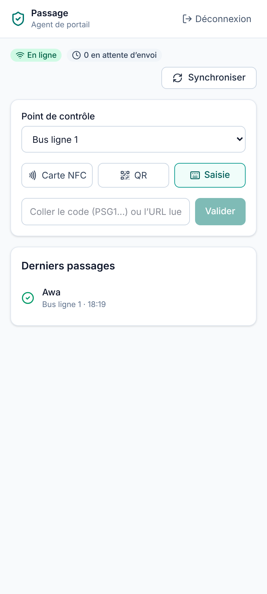
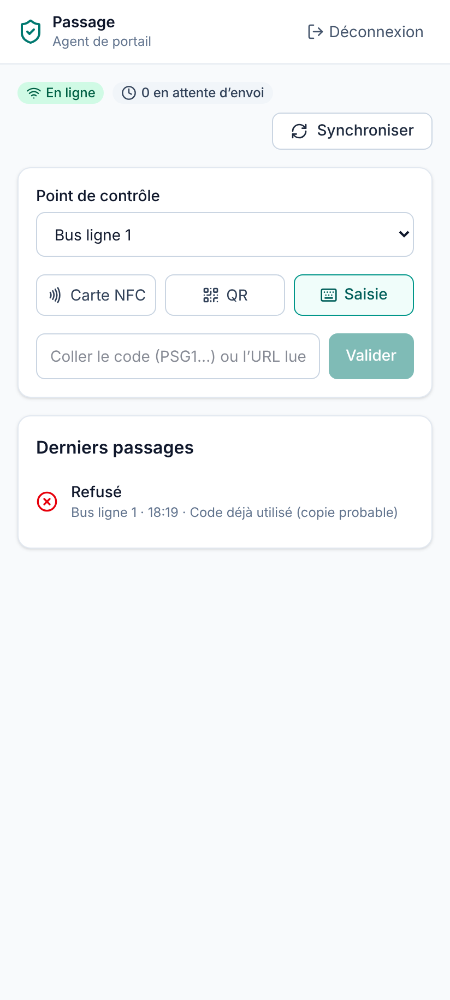
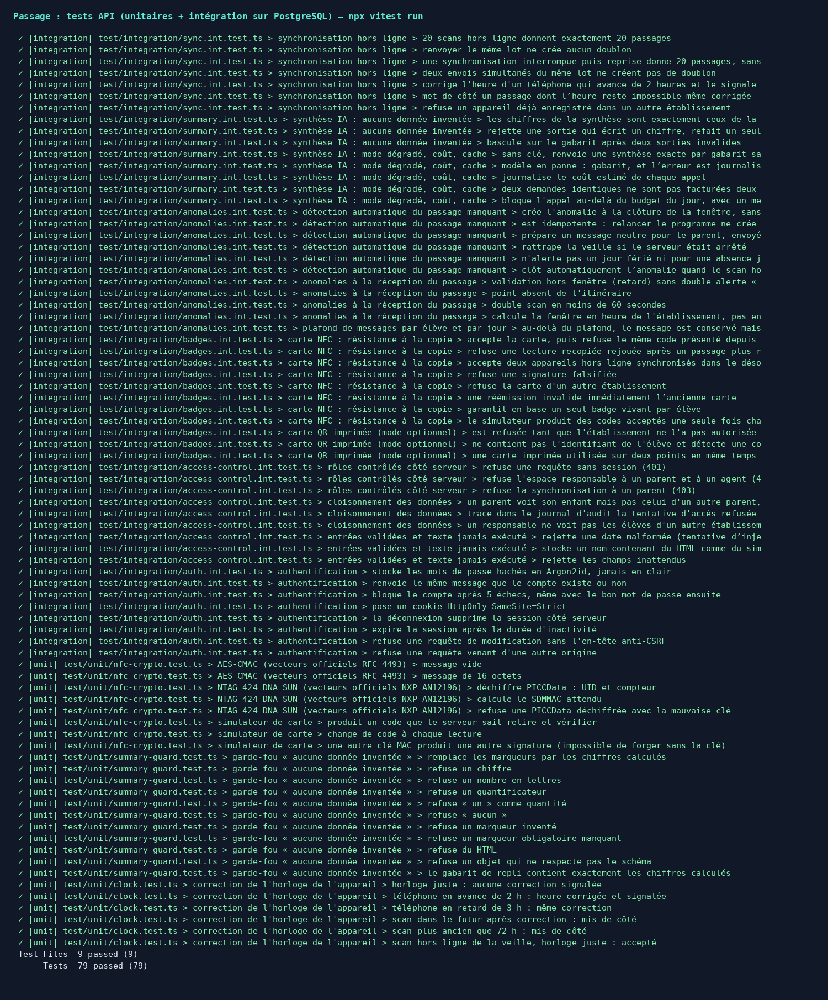

# Passage

Module de suivi des passages d'élèves par badge, pour SchoolLogs (test technique Afric'Éduc, sujet B).

L'agent de portail valide les badges **même sans réseau** ; le serveur détecte seul les passages manquants, prévient les parents, et produit une synthèse du jour avec un modèle de langage (Groq) **sans jamais laisser le modèle écrire un chiffre**.

[](https://github.com/takmalab/passage-africeduc/actions/workflows/ci.yml)
[](https://github.com/takmalab/passage-africeduc/actions/workflows/security.yml)

| Capture                                                      |                                                              |
| ------------------------------------------------------------ | ------------------------------------------------------------ |
|  |  |

## Sommaire

1. [Ce que fait l'application](#ce-que-fait-lapplication)
2. [Technologies et justification](#technologies-et-justification)
3. [Installation](#installation)
4. [Comptes de test](#comptes-de-test)
5. [Lancer les tests](#lancer-les-tests)
6. [Sécurité](#sécurité)
7. [Mode dégradé](#mode-dégradé)
8. [Ce qui n'est pas terminé](#ce-qui-nest-pas-terminé)
9. [Documentation](#documentation)

## Ce que fait l'application

| Exigence du sujet                                                     | Où                                                | État                                                                                             |
| --------------------------------------------------------------------- | ------------------------------------------------- | ------------------------------------------------------------------------------------------------ |
| 1. Authentification et rôles (agent, responsable, parent)             | `apps/api/src/modules/auth`, `middleware/auth.ts` | Fait, testé                                                                                      |
| 2. Gestion des badges, carte non nominative, anti-copie, cycle de vie | `modules/badges`                                  | Fait, testé (cartes NFC NTAG 424 DNA + cartes QR imprimées)                                      |
| 3. Validation des passages, même hors ligne                           | `apps/web/src/offline`, `modules/sync`            | Fait, testé (20 scans, coupure, renvoi)                                                          |
| 4. Horloge fausse de l'appareil                                       | `modules/sync/clock.ts`                           | Fait, testé (2 h d'avance)                                                                       |
| 5. Itinéraires, fenêtres, jours                                       | `modules/manager`, `RouteEditor.tsx`              | Fait : itinéraire de l'établissement appliqué à chaque élève, case « Ne prend pas le bus » (D14) |
| 6. Exceptions (férié, absence justifiée, sortie autorisée)            | `modules/manager`, `anomalies.service.ts`         | Fait, testé                                                                                      |
| 7. Anomalies (4 imposées + 2 ajoutées)                                | `modules/anomalies`                               | Fait, testé                                                                                      |
| 8. Notifications parents, interface fournisseur, plafond              | `modules/notifications`                           | Fait, testé                                                                                      |
| 9. Synthèse IA sous 4 garde-fous                                      | `modules/summary`                                 | Fait, testé                                                                                      |
| 10. Sécurité                                                          | voir [Sécurité](#sécurité)                        | Fait, testé                                                                                      |

**Anomalies :** passage manquant (détecté par le programme de fond, sans aucune requête), hors fenêtre, point hors itinéraire, double scan en moins de 60 s, **tentative de copie du badge** (notre 5e, justifiée dans DECISIONS.md D6), badge désactivé présenté.

## Technologies et justification

| Brique       | Choix                                                                                                            | Pourquoi                                                                                               |
| ------------ | ---------------------------------------------------------------------------------------------------------------- | ------------------------------------------------------------------------------------------------------ |
| Organisation | Monorepo npm workspaces : `apps/api`, `apps/web`, `packages/shared`                                              | Formats de badge et protocole de synchronisation partagés et testés une fois                           |
| API          | Node.js 22, Express 5, TypeScript, Zod 4                                                                         | Simple à lire et à expliquer ; Express 5 gère nativement les erreurs asynchrones                       |
| Base         | PostgreSQL 16, Prisma 7 (adaptateur `pg`)                                                                        | Index unique partiel, contraintes CHECK, `ON CONFLICT`, verrous : l'intégrité est garantie par la base |
| PWA          | Vite 8, React 19, vite-plugin-pwa, Dexie (IndexedDB), Tailwind 4                                                 | Toute l'application en cache, hors ligne fiable ; servie par Express sur la même origine               |
| Badges       | Cartes NFC NTAG 424 DNA (mode SUN), lues par Web NFC ; cartes QR imprimées en option                             | Voir DECISIONS.md D1                                                                                   |
| IA           | `openai/gpt-oss-120b` chez Groq (offre gratuite), sortie JSON schema stricte ; fournisseur interchangeable (D17) | Gratuit, rapide, sortie contrainte ; Mistral prévu à l'origine mais devenu payant                      |
| Tests        | Vitest, Supertest, vraie base PostgreSQL                                                                         | Les garanties critiques sont dans la base : on les teste sur une vraie base                            |
| CI           | GitHub Actions : lint, types, tests, build, migrations, Gitleaks, npm audit, CodeQL                              |                                                                                                        |

## Installation

Prérequis : Node.js 22+, PostgreSQL 16 (ou Docker), Git. **Sous Windows, un script installe tout ce qui manque (Git, Node, GitHub CLI) :**

```powershell
powershell -ExecutionPolicy Bypass -File scripts\setup.ps1 -RepoName passage
```

macOS / Linux : `bash scripts/setup.sh passage`. Ces scripts créent `.env` (avec une clé maîtresse aléatoire), installent les dépendances, appliquent les migrations, chargent les données de démonstration, et peuvent créer le dépôt GitHub public.

Installation manuelle :

```bash
cp .env.example .env              # puis renseigner DATABASE_URL et BADGE_KEYS_MASTER_KEY
docker compose up -d db           # PostgreSQL (crée aussi la base passage_test)
npm install
npm run db:deploy                 # migrations
npm run db:seed                   # données de démonstration reproductibles
npm run dev                       # API :3000 + PWA :5173 (http://localhost:5173)
```

Version « production » locale, en une commande : `docker compose up --build`, puis `docker compose exec app npm run db:seed`, puis http://localhost:3000.

Le service worker (hors ligne) n'est actif qu'avec la version construite : `npm run build && npm start` puis http://localhost:3000. Pour un téléphone sur le Wi-Fi local (caméra et NFC exigent HTTPS) : `npm run cert:lan`, voir `docs/DEPLOIEMENT.md`.

## Comptes de test

Mot de passe commun : `Passage2026!` (variable `SEED_PASSWORD`).

| Identifiant    | Rôle             | Ce qu'il voit                                          |
| -------------- | ---------------- | ------------------------------------------------------ |
| `responsable`  | Responsable      | Tout l'établissement, simulateur de carte, synthèse IA |
| `agent`        | Agent de portail | Écran de scan uniquement                               |
| `parent.awa`   | Parent           | Awa et Junior                                          |
| `parent.kevin` | Parent           | Kevin et Clarisse                                      |

Le seed crée 20 élèves (deux classes), 3 points de contrôle, l'itinéraire de l'établissement, une carte NFC **simulée** par élève et une journée complète de passages sur le dernier jour ouvré (avec retard, sortie hors plage, passages manquants, absence justifiée). La journée en cours reste vierge pour la démonstration.

## Lancer les tests

```bash
npm test            # tout : 100 tests (API 79, paquet partagé 16, PWA 5)
npm run test:int    # intégration API seule (base TEST_DATABASE_URL, recréée à chaque exécution)
npm run verify      # lint + types + tests + build, comme la CI
```

Tests marquants : 20 scans hors ligne = 20 passages ; synchronisation interrompue sans doublon ; deux envois simultanés ; horloge en avance de 2 h ; code de carte recopié refusé ; réémission ; passage manquant détecté par le programme de fond ; plafond de messages ; synthèse comparée à un comptage SQL indépendant ; mode sans clé ; budget ; cache ; vecteurs officiels NXP AN12196 et RFC 4493.



## Sécurité

| Exigence                                   | Implémentation                                                                                                                                                                                          | Test                         |
| ------------------------------------------ | ------------------------------------------------------------------------------------------------------------------------------------------------------------------------------------------------------- | ---------------------------- |
| Mots de passe hachés, 8 caractères minimum | Argon2id, paramètres OWASP (`modules/auth/password.ts`)                                                                                                                                                 | `auth.int.test.ts`           |
| Tentatives limitées, même message          | 5 échecs = blocage 15 min par compte + limite par IP ; message unique ; hachage factice si le compte n'existe pas (`auth.service.ts`)                                                                   | `auth.int.test.ts`           |
| Session limitée, déconnexion effective     | Jeton aléatoire, cookie `HttpOnly` `SameSite=Strict` (`Secure` en production), empreinte SHA-256 en base, 30 min d'inactivité, 8 h maximum, suppression serveur à la déconnexion (`middleware/auth.ts`) | `auth.int.test.ts`           |
| Rôles contrôlés côté serveur               | `requireRole()` sur chaque routeur                                                                                                                                                                      | `access-control.int.test.ts` |
| Cloisonnement                              | Filtre « mes enfants » dans la requête SQL, réponse 404 identique à un élève inexistant, tentative tracée dans l'audit (`parent.service.ts`)                                                            | `access-control.int.test.ts` |
| Entrées validées, requêtes paramétrées     | Zod `.strict()` sur chaque entrée, Prisma, SQL brut uniquement en gabarits balisés                                                                                                                      | `access-control.int.test.ts` |
| Pas de script exécuté                      | React échappe tout ; `dangerouslySetInnerHTML` interdit par ESLint ; CSP stricte (Helmet)                                                                                                               | `access-control.int.test.ts` |
| Aucun secret dans le dépôt                 | `.env` ignoré, `.env.example` sans valeur, Gitleaks sur tout l'historique en CI                                                                                                                         | `security.yml`               |
| Badge non nominatif, non copiable          | Carte NFC : signature AES par lecture, compteur à usage unique, clés dérivées jamais stockées en base                                                                                                   | `badges.int.test.ts`         |

En plus : protection CSRF (en-tête obligatoire + contrôle d'origine), journal d'audit des consultations, taille des requêtes limitée, aucune donnée d'élève mise en cache par le service worker.

## Mode dégradé

| Situation                                                              | Comportement                                                                                     |
| ---------------------------------------------------------------------- | ------------------------------------------------------------------------------------------------ |
| Pas de clé d'IA (`AI_API_KEY` vide)                                    | Synthèse produite par gabarit, mêmes chiffres, origine « Gabarit » affichée, aucun appel         |
| Fournisseur en panne, refus (ex. abonnement) ou plus de 8 s            | Un seul nouvel essai, puis gabarit ; l'erreur et son explication sont journalisées dans `AiCall` |
| Sortie du modèle invalide (schéma, chiffre écrit, quantité en lettres) | Un seul nouvel essai, puis gabarit                                                               |
| Budget du jour atteint (`AI_DAILY_BUDGET_USD`)                         | Appel bloqué, message clair, gabarit                                                             |
| Même demande déjà faite                                                | Résultat servi depuis le cache, non facturé                                                      |
| Réseau coupé au portail                                                | Scans gardés dans IndexedDB, envoi automatique au retour du réseau                               |
| Session expirée pendant le hors ligne                                  | Les scans restent sur le téléphone jusqu'à la reconnexion                                        |
| Serveur arrêté à la clôture d'une fenêtre                              | Rattrapage au redémarrage (veille comprise)                                                      |

## Ce qui n'est pas terminé

Dit honnêtement, par ordre d'importance :

- **Cartes NFC réelles non testées sur du matériel.** Le calcul est vérifié avec les vecteurs officiels de NXP (AN12196) et le simulateur produit exactement les mêmes codes, mais aucune carte physique n'a été programmée pendant le test. La procédure de programmation est décrite dans `docs/BADGES.md`.
- **Le verdict hors ligne n'est pas immédiat** : le téléphone de l'agent ne détient pas les clés, la vérification se fait à la synchronisation.
- **Envoi réel de SMS** : seule l'interface et la boîte d'envoi existent.
- **Gestion multi-établissements** : le modèle la supporte, mais il n'y a pas d'écran d'administration globale : les établissements et les comptes responsables sont créés par le seed. Le responsable crée lui-même ses classes, points de contrôle, agents et comptes parents (DECISIONS.md, D13).
- **Mot de passe provisoire** : il n'y a pas encore d'écran « changer mon mot de passe » ni d'obligation de le changer à la première connexion.
- **Interface** : volontairement sobre. Un compte parent dont on retire le dernier lien reste en base sans accès à aucun élève ; il n'y a pas d'écran de suppression de compte.
- **Mise à l'échelle** : non traitée (non demandée).

## Documentation

| Fichier                                      | Contenu                                          |
| -------------------------------------------- | ------------------------------------------------ |
| [DECISIONS.md](DECISIONS.md)                 | Décisions techniques et ce qui a été écarté      |
| [JOURNAL-IA.md](JOURNAL-IA.md)               | Usage de l'IA dans le développement              |
| [docs/STEPS.md](docs/STEPS.md)               | Feuille de route pas à pas jusqu'à l'envoi       |
| [docs/ARCHITECTURE.md](docs/ARCHITECTURE.md) | Architecture, flux, modèle de données            |
| [docs/BADGES.md](docs/BADGES.md)             | Cartes NFC SUN, cartes QR, programmation         |
| [docs/DEPLOIEMENT.md](docs/DEPLOIEMENT.md)   | HTTPS local, base en ligne, hébergement          |
| [docs/RESTITUTION.md](docs/RESTITUTION.md)   | Préparation de l'entretien                       |
| [docs/video/](docs/video/)                   | Scripts de la démo et de la capsule, sous-titres |
| [CLAUDE.md](CLAUDE.md)                       | Consignes pour Claude Code dans ce dépôt         |
